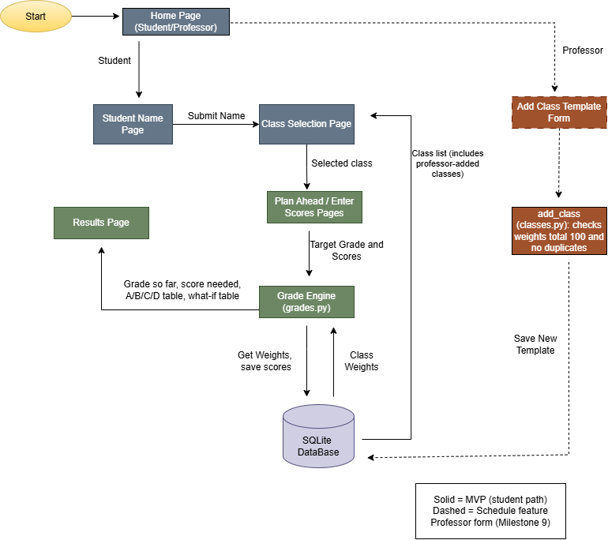

# Grade Predictor

A free website where first-year students enter the scores they already have and see what they need on the rest of a class to reach a target grade, like a B.

## The Problem

As a freshman, I'm still figuring out how to manage my classes. The question I keep asking is "what do I need on the final to get a B?", and it is annoying to work out by hand from a syllabus. The sites I found are either expensive or only cover one small piece of what I wanted.

I wanted a simple webiste that does the math for me.

## How It Works

The home page lets you choose **Student** or **Professor**. This is a menu, not a login [It is listed in Known Limitations]

**Students** enter a name, pick a class, and choose one of two modes:

- **I have no scores yet (plan ahead):** pick a target grade (a number like 90, or a letter like B) and a category to test. The site shows how many points you can afford to lose in total, and what you would need on everything else for different scores in that category.
- **I'll enter my scores:** type the scores you already have and leave unfinished categories blank. The site shows your grade so far, what you need on the remaining work for your target, and what you need for each letter grade (A, B, C, D).

**Professors** enter a class name and a table of assignment types and weights. The weights must add up to 100. The class is saved in the same database and shows up in the students' dropdown.



### Files

- `database.py` creates the SQLite tables (classes, categories, scores).
- `classes.py` has `add_class`, which checks that the weights add up to 100 and saves a class, plus the starter classes.
- `grades.py` has the grade math (points earned, current grade, score needed, what-if table, letter targets).
- `predict.py` is a terminal version of the predictor.
- `app.py` is the Flask website, and `templates/` holds its HTML pages.

### The math

- points earned = weight x score / 100, for each category that has a score
- current grade = points earned / weight graded x 100
- score needed on the rest = (target - points earned) / weight remaining x 100

## Tech Stack

- **Language:** Python 3, plus HTML and CSS
- **Libraries:** Flask (web framework and Jinja templates), `sqlite3` (included with Python)
- **Data storage:** SQLite database file (`grades.db`), created when you run the setup commands
- **External services:** none, so no internet connection or API key is needed
- **Tools:** Git and GitHub, VS Code, draw.io (system diagram)

## Setup

You need Python 3 and Git installed. On Mac or Linux, use `python3` instead of `python`.

```
git clone https://github.com/npoduval123/Grade-Predictor-.git
cd Grade-Predictor-
python -m pip install -r requirements.txt
python database.py
python classes.py
python app.py
```

Then open http://127.0.0.1:5000 in your browser. Press Ctrl + C in the terminal to stop the server.

`database.py` creates the empty tables and `classes.py` adds the starter classes (CS 180, MA 161, SCLA 101, CHEM 217). To try the terminal version instead of the website, run `python predict.py`.

### Example

This example works for anyone who clones the repo, because it uses a class added through the professor form.

1. On the home page, click **Professor** and add a class called `DEMO 101` with these weights:

   | Assignment Type | Weight (%) |
   |---|---|
   | Homework | 20 |
   | Midterm | 30 |
   | Final | 50 |

   If you type weights that add up to anything other than 100, the form shows a red error and does not save.

2. Go back to the home page, click **Student**, enter any name, and pick **DEMO 101**.
3. Click **I'll enter my scores**. Enter `90` for Homework, `80` for Midterm, leave Final blank, type `B` as the target, and click Calculate.

Output:

```
Your grade so far: 84.0%
To finish with 80.0%: need 76.0% on the remaining work

For each letter grade:
A (90%): need 96.0% on the remaining work
B (80%): need 76.0% on the remaining work
C (70%): need 56.0% on the remaining work
D (60%): need 36.0% on the remaining work
```

How to check it by hand: Homework gives 20 x 90 / 100 = 18 points and Midterm gives 30 x 80 / 100 = 24 points, so 42 points out of the 50% graded so far. 42 / 50 = 84%. For a B: (80 - 42) / 50 = 76%.

## Roadmap

- [x] SQLite database with classes, categories, and scores
- [x] Starter classes and the weights-add-up-to-100 check
- [x] Current grade and score needed on the remaining work
- [x] Letter-grade targets and an A / B / C / D table
- [x] What-if table and points you can afford to lose
- [x] Terminal version (`predict.py`)
- [x] Flask website for students
- [x] Professor form to add class templates (Schedule feature, built on the `professor-form` branch and merged into `main`)
- [ ] Real login with separate student and professor roles
- [ ] Saved scores for each student
- [ ] Letter-grade cutoffs set per class
- [ ] Several items inside one category (for example, 5 of 8 homeworks done)
- [ ] GPA across classes
- [ ] Homework list, calendar, habit tracker, and reminders
- [ ] Syllabus file upload

## What Changed Since the Plan

- **The idea got smaller.** My original problem named four tools in one site: a grade predictor, a to-do list, a habit tracker, and a homework tracker. I narrowed it to the grade predictor so I could build it properly and explain all of it.
- **Mode 1 changed.** My first "no scores yet" answer only repeated the target back to the user. I replaced it with a what-if table and the points you can afford to lose.
- **Letter targets were added** so you can type a B and see what each letter needs.
- **Upload became a form.** Syllabi are formatted differently everywhere, so reading them automatically is unreliable. Professors type the assignment types and weights into a form instead.
- **Login moved to future plans.** The home page asks for Student or Professor but does not lock anything yet.
- **The weights check moved into one place** (`add_class`) after I noticed it was written twice.

## Known Limitations

- Each category holds one score. If a category is only partly done (5 of 8 homeworks), leave it blank.
- Letter cutoffs are fixed at 90 / 80 / 70 / 60. You can type an exact number as the target instead.
- There is no login. Scores are saved per class on one computer, so everyone using the same copy of the app shares them.
- The professor page is not protected, so anyone who opens it can add a class.
- The professor form allows up to 8 assignment types per class.
- 

## AI Use

AI was used after I entered the prompt provided in the project PDF to help me learn HTML and Flask. It helped me understand how Flask works and the overall workflow of the application. Since I had learned SQL before, AI also helped me understand the difference between SQL and SQLite. I provided the sequence of functions I wanted to implement and used AI to understand how to approach and implement them. No complete code was generated by AI; I wrote the code myself with AI's help in understanding the concepts and debugging issues.

## Planning Documents

- [Eisenhower Matrix (PDF)](Eisenhower%20Matrix.pdf)
- System diagram source: `SystemDiagram.drawio`

## Demo

[Paste your unlisted YouTube link here]
